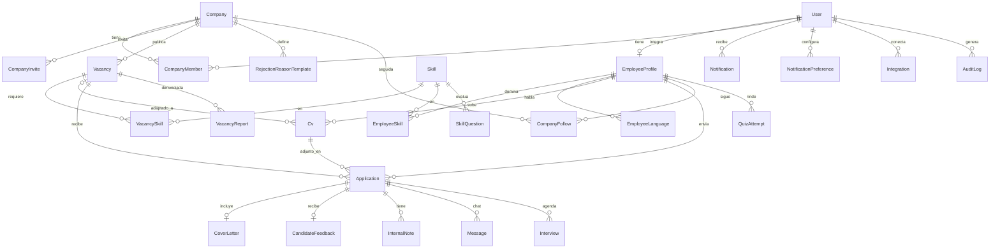

# Modelo de datos

Fuente de verdad: [`prisma/schema.prisma`](../prisma/schema.prisma).

## Enumeraciones

| Enum | Valores |
| --- | --- |
| Role | EMPLOYEE, EMPLOYER, ADMIN |
| UserStatus | ACTIVE, SUSPENDED |
| VerificationStatus | PENDING, APPROVED, REJECTED |
| VacancyStatus | ACTIVE, PAUSED |
| Stage | REVIEW, INTERVIEW, HIRED, REJECTED |
| FileType | PDF, DOCX |

## Reglas

- `Application` es única por `(vacancyId, employeeId)`.
- `Cv.isBase = true` y `vacancyId` nulo es el CV base; con `vacancyId` es una versión adaptada.
- El archivo del CV vive en almacenamiento de objetos (`storageKey`); `extractedText` lo usa el analizador.
- `rejectionReason` es siempre opcional.
- `InternalNote` jamás se devuelve en endpoints de empleado.
- Los datos sensibles del candidato se ocultan según `Application.stage`.
- `stage` solo lo cambia una persona y cada cambio se registra en `AuditLog`.
- `Interview.calendarEventId` e `Integration.encryptedToken` van cifrados y no se devuelven por la API.
- `User.passwordHash` (argon2id) y `User.totpSecretEncrypted` nunca se devuelven por la API. `totpSecretEncrypted` es el secreto del 2FA del ADMIN, cifrado con AES-256-GCM usando `ENCRYPTION_KEY`; es nulo para EMPLOYEE y EMPLOYER.
